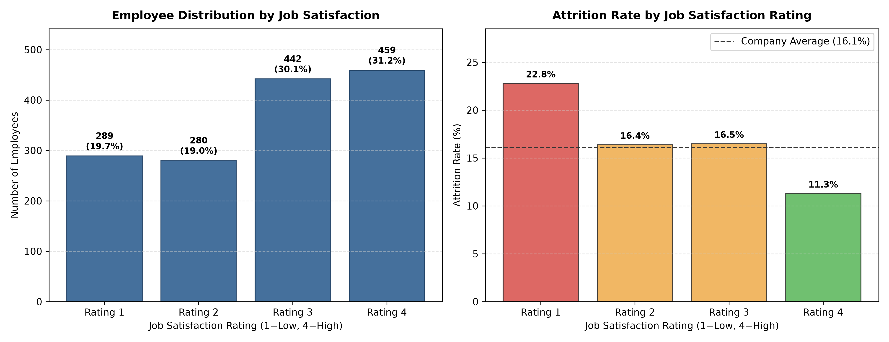

# Analysis of Workforce Stability using ML and AI to Make Predictions

Jasmine Saenz 
MIS 4320 Data Mining and Busi Intel 
Dr. Haibo Wang 
November 22, 2026 

---

## 1. Executive Summary
High personnel turnover disrupts operations, lowers team morale, and generates substantial recruiting and onboarding costs. Using Python ('pandas' , 'matplotlib', and 'dataclasses'), this project analyzes the IBM HR Analytical dataset (1,470 employees) to quantify conditional attrition risk across job satisfaction tiers. Findings reveal an overall company attrition rate of **16.1%**, with low-satisfaction employees (rating 1) departing at **22.8%** , more than double to **11.3%** rate of highly satisfied staff (rating 4).

---

## 2. Introduction to the Business Problem
* **Organizational Challenge:** The org experiences a high personnel turnover rate that causes unstable work environments, impairs team morale, interfeers with daily operations, and depletes institutional knowledge.
* **Financial Friction:** Employee departure impose heavy financial burdens through recruiting, interviewing, and training replacement staff.
* **Need for Proactive Analytics:** Relying on reactive exit interviews prevents management form interviewing before valuable staff quit. A proactive, data-driven workforce stability strategy is needed to identify high-risk employee segments and uncover the drivers behind attrition.

---

## 3. Project Objectives
1. **Determine Attrition Drivers:** Identify operational, financial, and behavioral characteristics that distinguished departed personnel from retained staff using exploratory data analysis (EDA).
2. **Quantity Segment Impacts:** Build focused visualizations demonstrating how attrition rates differ across satisfaction tiers and organizational groups.
3. **Forecast Risk & Evaluate Models:** Apply analytical modeling and survival/classification techniques to identify high-risk workers while balancing precision, recall, and F1-Score to minimize false alarms.

---

## 4. Dataset Overview & Data Preparation
* **Source:** [IBM HR Analytics Employee Attrition & Performance Dataset (Kaggle)](https://kaggle.com) simulating a mid-sized enterprise across R&D, Sales, and Human Resources.
* **Dimensions:** **1,470 employee records** partitioned into **1,233 retained employees** (`No`) and **237 departed employees** (`Yes`).
* **Key Variables:**
  * `JobSatisfaction`: Engagement metric coded on a 1–4 scale (`1` = Low satisfaction, `4` = High satisfaction).
  * `Attrition`: Binary outcome tracking whether an employee remained active (`No`) or left (`Yes`).
  * **Derived Metrics:** Workforce distribution (%), category attrition rate (%), and category retention rate (%).
* **Privacy & Governance:** All records are anonymized and scrubbed of personal identifiers prior to Python processing.

## Data Engineering Pipeline ('src/')
To ensure data integrity and zero side effects, a modular Python preprocessing pipeline was built:
* **Automated Ingestion & Validation:** Dynamic file discovery (`resolve_dataset_path`) with an embedded contingency fallback and custom `DataValidationError` checks.
* **Header Normalization:** Programmatic detection of Excel pivot-table header offsets, whitespace stripping, and isolation of summary `Grand Total` rows from tiers 1–4.
* **Immutability & Type Safety:** Explicit DataFrame copies (`.copy()`), strict numeric type enforcement, and an immutable `AttritionMetrics` dataclass to prevent accidental state changes during reporting.

---

## 5. Analytical Methodology
* **Proportional Distribution Analysis:** Calculated each satisfaction tier's share of the total workforce (`Total in Tier / 1,470`) to identify employee concentration.
* **Conditional Attrition & Retention Modeling:** Computed tier-specific turnover risk (`Left / Total in Tier`) and retention stability (`Stayed / Total in Tier`) so larger cohorts do not mask high relative risk.
* **Company Benchmark Comparison:** Established the **16.1%** organization-wide attrition rate as a baseline reference line to isolate high-risk segments.
* **Modular Visualization Architecture:** Built a decoupled `matplotlib` pipeline (`create_satisfaction_charts`) outputting 300 DPI dual-panel charts with risk-based color encoding (Red = High risk, Amber = Moderate risk, Green = Low risk).

---

## 6. Key Findings & Statistical Results

Across all 1,470 employees, **83.9% (1,233)** remained with the company while **16.1% (237)** separated:

| Satisfaction Level | Stayed (No) | Left (Yes) | Total Employees | Workforce Distribution (%) | Attrition Rate (%) | Retention Rate (%) |
| :--- | :---: | :---: | :---: | :---: | :---: | :---: |
| **Satisfaction 1 (Low)** | 223 | 66 | 289 | 19.7% | **22.8%** | 77.2% |
| **Satisfaction 2** | 234 | 46 | 280 | 19.0% | 16.4% | 83.6% |
| **Satisfaction 3** | 369 | 73 | 442 | 30.1% | 16.5% | 83.5% |
| **Satisfaction 4 (High)** | 407 | 52 | 459 | 31.2% | **11.3%** | 88.7% |
| **Grand Total / Overall** | **1,233** | **237** | **1,470** | **100.0%** | **16.1%** | **83.9%** |

* **Inverse Relationship:** Job satisfaction strongly correlates with retention. Employees in Rating 1 depart at **22.8%**, more than double the **11.3%** rate of Rating 4.
* **High-Volume Attrition Risk:** Although Rating 3 has a moderate attrition rate (**16.5%**), its large headcount (**442 employees**) produces the highest raw volume of departures (**73 employees**).

---

## 7. Visualizations

* **Left Panel (Employee Distribution):** Shows headcount concentration across satisfaction levels, highlighting that Rating 4 (459 employees; 31.2%) and Rating 3 (442 employees; 30.1%) comprise 61.3% of the workforce.
* **Right Panel (Attrition Rate vs. Job Satisfaction):** Contrasts tier-specific attrition against the 16.1% corporate average dashed line. Rating 1 (22.8%, red) spikes well above average, Ratings 2 and 3 hover near the baseline, and Rating 4 (11.3%, green) demonstrates strong stability.

---

## 8. Conclusions & Recommendations
1. **Launch Targeted Interventions for Rating 1 Staff:** Conduct immediate, confidential stay-interviews and manager coaching for employees scoring `1` on engagement surveys to resolve role friction before resignation occurs.
2. **Address High-Volume Attrition in Rating 3:** Because Rating 3 generates the most total departures (73 staff), introduce career-pathing workshops and workload audits to shift Rating 3 employees upward into Rating 4.
3. **Automate Quarterly Pulse Tracking:** Deploy the refactored Python pipeline (`create_satisfaction_charts`) on quarterly HR pulse surveys to monitor whether departmental attrition moves closer to the 11.3% Rating 4 benchmark.

---

## 9. Repository Navigation & References
* [`src/`](src/) — Refactored Python preprocessing and visualization source code.
* [`data/`](data/) — Input HR analytics dataset.
* [`visuals/`](visuals/) — Exported 300 DPI analytical figures.

### References
* Hunter, J. D. (2007). Matplotlib: A 2D graphics environment. *Computing in Science & Engineering*, 9(3), 90–95.
* McKinney, W. (2010). Data structures for statistical computing in Python. *Proceedings of the 9th Python in Science Conference*.
* Pavansubhash. (2017, March 31). *IBM HR Analytics Employee Attrition & Performance*. Kaggle. https://kaggle.com
